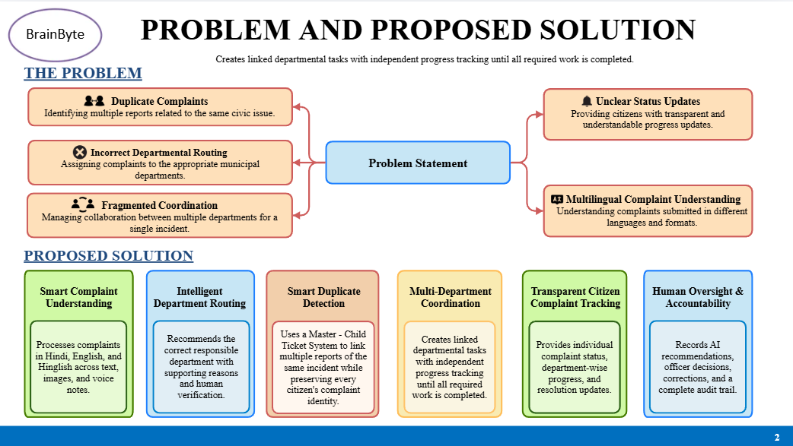
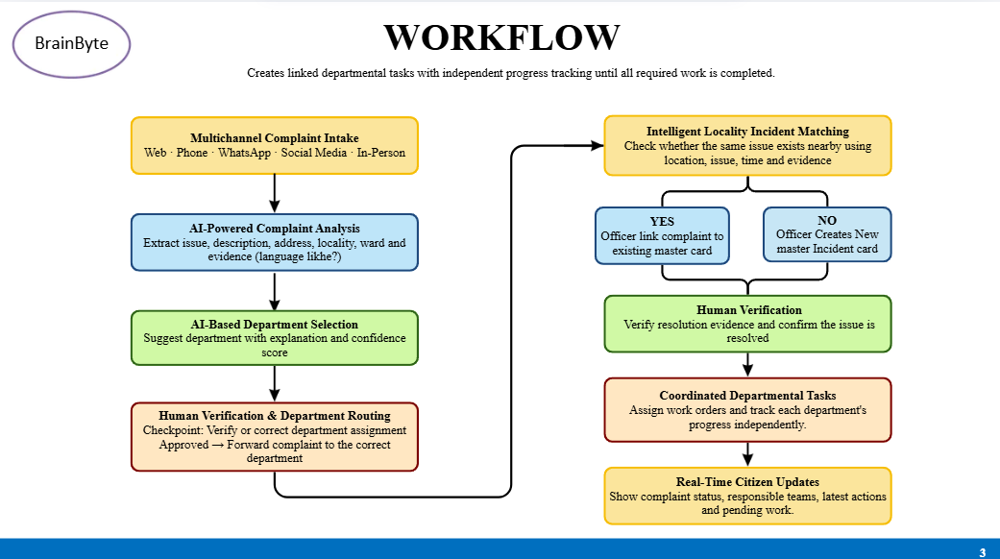

# BrainByte — AI-Powered Municipal Grievance Management System

**AI Synergy Hackathon · IIIT Gwalior**  
**Case 07: Governance — One Complaint, Five Departments**

## Overview

BrainByte is a proposed AI-assisted municipal grievance management system designed to improve how civic complaints are understood, routed, linked to incidents, coordinated across departments, and communicated to residents.

Municipal complaints arrive through multiple channels and may describe the same incident in different words. Residents may not know which department is responsible, staff may repeatedly forward complaints, and generic status messages can leave citizens unsure about what is happening. Some incidents may also require multiple departments to complete related work.

BrainByte aims to turn fragmented complaint handling into a more coordinated, transparent, and accountable process—while keeping important decisions subject to human review.

**Our goal:** Help municipal teams act on the right incident, involve the right departments, and give citizens clearer information about progress.

## The Problem

The case highlights several connected challenges:

- **Duplicate complaints:** Multiple residents may report the same pothole, leaking pipeline, overflowing drain, or garbage accumulation through different channels and descriptions.
- **Incorrect departmental routing:** Unclear responsibility can lead to complaints being forwarded between departments and delay action.
- **Fragmented interdepartmental coordination:** A single incident may require more than one department to complete related tasks.
- **Unclear status updates:** Generic labels such as “In Process” do not tell residents which team is responsible, what has been done, or what remains pending.
- **Multilingual complaint understanding:** Reports may contain English, Hindi, Hinglish, photographs, or voice notes.
- **Accountability and fair prioritisation:** Officials need reviewable reasons for routing and prioritisation decisions. Low complaint volume must not automatically mean low urgency, particularly where public safety may be involved.

The case provides a **simulated** finding that 23% of grievances in its sample were reassigned at least once. This is evidence of a routing concern within the scenario, not a verified real-world statistic or proof of a single root cause.

## Proposed Solution

### 1. Smart Complaint Understanding

Analyse complaint text and available evidence to extract structured details such as issue category, location, ward, and relevant context. The system should handle English, Hindi, and Hinglish where supported, and preserve uncertainty when descriptions are incomplete or ambiguous.

Photographs and voice notes can provide additional context, but should not be treated as conclusive proof without suitable validation.

### 2. Intelligent Department Routing

Recommend a responsible department based on the complaint details and available municipal rules or category mappings. Each recommendation should include an understandable reason and a confidence indication.

A human official reviews the recommendation before formal routing. Low-confidence, conflicting, or incomplete cases should be sent for clarification or manual review rather than silently assigned or dismissed.

### 3. Smart Duplicate and Incident Detection

Compare reports using signals such as:

- Location and geographic proximity.
- Issue category and description.
- Reported time and incident context.
- Available photographs or other supporting evidence.

When reports appear to describe the same incident, recommend linking them to a shared **Master Incident**. Each citizen's complaint keeps its own reference number and individual details. Linking must not erase distinct concerns or automatically close any complaint.

An authorised official confirms uncertain matches and can keep reports separate when they concern different incidents.

### 4. Multi-Department Coordination

For incidents requiring joint action, create linked departmental tasks under one master incident. The workflow can identify a lead department, assign supporting tasks, track each department's progress independently, and show dependencies or pending work.

**Example:** A leaking water pipeline damages a road. The Water Supply Department may need to repair the leak, while the Engineering Department may need to restore the road surface. Both tasks can be tracked under one incident without confusing their individual responsibilities.

This coordination need is a plausible design requirement; its actual frequency should be validated using municipal records or staff feedback.

### 5. Transparent Citizen Complaint Tracking

Provide useful, authorised progress updates rather than relying only on generic labels. Depending on municipal policy and the case's sensitivity, updates may include:

- Current complaint and incident status.
- Responsible department or team.
- Actions completed so far.
- Pending tasks or dependencies.
- The next expected step, when known.

Updates should distinguish confirmed facts from estimates. Internal notes, sensitive personal information, and security-sensitive details should not be exposed indiscriminately.

### 6. Human Oversight and Accountability

Maintain an auditable history of material system and human actions, including:

- AI recommendations and their supporting reasons.
- Confidence or uncertainty indicators where available.
- Human approvals, overrides, and corrections.
- Complaint-to-incident linking and unlinking decisions.
- Departmental task assignments and status changes.
- Citizen correction or appeal requests and their outcomes.

AI must not independently reject or close a legitimate complaint solely because of a score. Residents should have an accessible way to challenge incorrect classifications or incident matches, and authorised officials should be able to review and correct them.

## System Workflow

The proposed workflow is:

1. **Multichannel intake:** Receive complaints through supported channels such as a web portal, phone-assisted entry, WhatsApp, social media, or in-person offices. Actual integrations depend on available APIs and municipal access.
2. **AI-powered analysis:** Extract the issue, location, ward, language, and relevant evidence into a structured complaint record.
3. **Department recommendation:** Suggest a department with a reason and confidence indication.
4. **Human verification and routing:** An authorised official reviews the recommendation and confirms or corrects the assignment.
5. **Incident matching:** Check whether the complaint may relate to an existing local incident using location, issue, time, and evidence.
6. **Human-confirmed incident record:** An official decides whether to link the complaint to an existing master incident or create a new one.
7. **Coordinated departmental tasks:** Assign and track the required work for each department independently.
8. **Citizen updates:** Communicate the complaint status, responsible teams, completed actions, and pending work, subject to disclosure rules.
9. **Resolution verification:** Record the available resolution evidence and require the appropriate human confirmation before the incident is marked resolved. Any closure must follow municipal policy and preserve an appeal path.

## Design Principles

- **Human-in-the-loop:** AI assists; authorised officials remain accountable for consequential decisions.
- **No score-only rejection or closure:** An AI score must not be the sole basis for rejecting or closing a complaint.
- **Explainability:** Routing, matching, and prioritisation recommendations should include reasons that staff can review.
- **Preserve complaint identity:** Related reports can share a master incident without losing individual complaint records.
- **Safety-aware prioritisation:** Consider potential severity and public-safety risk, not just complaint frequency or popularity.
- **Accessible correction and appeal:** Residents need a practical way to report mistakes and request review.
- **Auditability and privacy:** Record material decisions while protecting personal and sensitive information.
- **Uncertainty-aware AI:** Ambiguous, sarcastic, incomplete, or conflicting reports should trigger clarification or human review when needed.

## Expected Benefits

If validated and implemented effectively, BrainByte could:

- Reduce unnecessary duplicate handling.
- Help staff route complaints more consistently.
- Improve coordination across departments.
- Make complaint progress easier for residents to understand.
- Improve traceability of assignments, corrections, and decisions.
- Help officials identify potentially urgent incidents without relying on report volume alone.

These are intended outcomes, not claims of measured impact. They should be evaluated through a pilot.

## Proposed Evaluation Metrics

A pilot could measure:

| Area | Example metric |
|---|---|
| Duplicate detection | Precision and recall of suggested incident matches, reviewed by staff |
| Department routing | Recommendation accuracy and rate of human overrides |
| Workflow efficiency | Reassignment frequency and time to first correct assignment |
| Coordination | Time spent waiting on interdependent departmental tasks |
| Transparency | Percentage of updates that communicate a meaningful action or next step |
| Safety | Review of high-risk cases and missed-urgency incidents |
| Accountability | Completeness of audit records and time to resolve correction requests |
| Citizen experience | Feedback on clarity, accessibility, and perceived fairness |

Baseline measurements and pilot results are needed before claiming improvement.

## Implementation Plan

### Phase 1 — Minimum Viable Prototype

- Build a complaint submission and staff review interface.
- Create a structured complaint model and a configurable department/category mapping.
- Implement AI-assisted extraction and routing recommendations.
- Display reasons and uncertainty for staff review.
- Maintain a basic audit trail.

### Phase 2 — Incident Matching

- Add location- and text-based similarity checks.
- Recommend possible duplicate or related incidents.
- Support human-confirmed linking and unlinking.
- Preserve each original complaint and its reference number.

### Phase 3 — Multi-Department Workflow

- Add master incidents and linked departmental tasks.
- Track each task's owner, status, dependencies, and updates.
- Define rules for lead-department ownership and resolution verification.

### Phase 4 — Citizen Transparency and Evaluation

- Add citizen-facing status timelines and correction/appeal requests.
- Apply role-based access and privacy controls.
- Test with representative multilingual and ambiguous examples.
- Evaluate routing, matching, safety, and workflow performance with human-reviewed ground truth.

**Feasibility note:** A hackathon prototype can demonstrate the core workflow with sample data and simulated integrations. Real phone, social-media, WhatsApp, municipal database, and departmental integrations require access, permissions, and deployment-specific work.

## Scope and Limitations

- AI may misunderstand sarcasm, local expressions, incomplete descriptions, or mixed-language reports.
- Similar locations and descriptions do not guarantee that two complaints refer to the same incident.
- Confidence values are not guarantees of correctness and must be calibrated and evaluated.
- Photo or voice analysis may be limited by quality, availability, language support, and privacy constraints.
- Real-time departmental updates depend on staff adoption and reliable integration.
- The system cannot establish the actual root causes of reassignment without further evidence.
- Human review, correction, and appeal processes are essential safeguards, not optional additions.

## Case Study Alignment

BrainByte responds to the case's open questions by comparing plausible failure points across intake, deduplication, routing, coordination, transparency, and accountability. Rather than treating any one root cause as proven, the proposed system supports human-reviewed recommendations and an auditable workflow. The team should validate its assumptions with complaint samples, staff feedback, and pilot measurements.

## Team

**BrainByte**  
AI Synergy Hackathon — IIIT Gwalior  
Case 07: Governance — One Complaint, Five Departments

---

*Status: Proposed solution and workflow for a hackathon case study. Features and integrations should be described as implemented only after they have been built and tested.*
